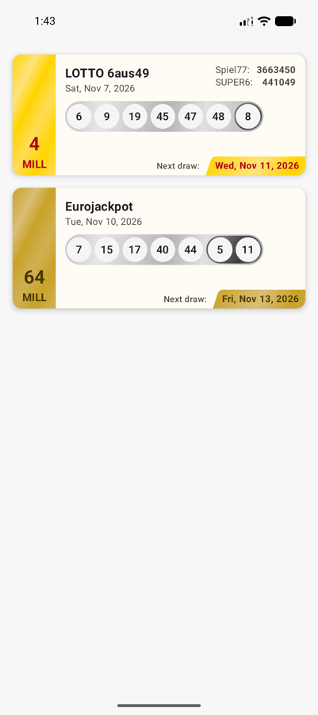
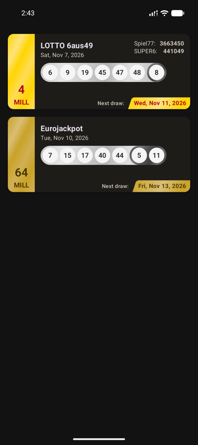
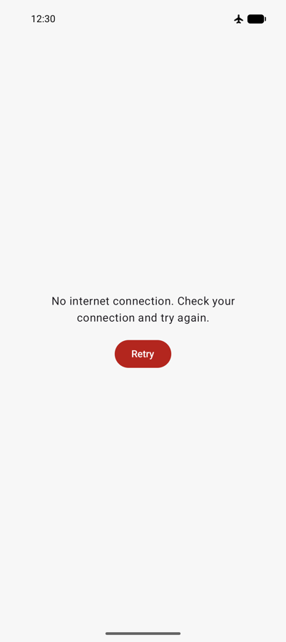

# Lotto CC

A small native Android app that shows the latest draw results, jackpot heights and next draw dates
for **LOTTO 6aus49** (with Spiel 77 and SUPER 6) and **Eurojackpot**, so you can decide whether to
play the next draw.

| Light | Dark | Offline |
|---|---|---|
|  |  |  |

## Features
**Must have (case study)**
- Drawn numbers shown as balls; the **Superzahl** and the **Eurozahlen** are set apart in a darker
  group.
- Next draw date in a badge.
- Jackpot height in the card's side strip ("4 MILL" / "4 MIO"), hidden when it isn't announced yet.
- Built with Jetpack Compose.

**Bonus**
- Spiel 77 and SUPER 6 numbers on the LOTTO 6aus49 card.
- Tapping a card opens https://www.lotto24.de (or the LOTTO24 app, when it handles the link).

**Also**
- English and German; dates and amounts are formatted for the device's language and time zone.
- Light and dark theme; loading and error states with Retry.
- Accessibility:
  - Text contrast meets WCAG AA.
  - Layouts adapt to large font sizes and right-to-left languages.
  - Screen readers announce bonus numbers ("Superzahl 7") and read Spiel 77 / SUPER 6 digit by digit.

**Not included:** the home-screen widget (out of scope) and pull-to-refresh (planned, deferred).
See [Known limitations](#known-limitations).

## Tech stack
| Area | Choice |
|---|---|
| Language & UI | Kotlin 2.4, Jetpack Compose (BOM 2026.09), Material 3 |
| Architecture | Clean Architecture, MVVM, use cases, multi-module Gradle build |
| Async | Coroutines, `StateFlow` |
| Networking | Retrofit 3, OkHttp 5, kotlinx.serialization |
| DI | Koin 4.2 with the **Koin Compiler Plugin**: the whole graph is checked when the app compiles |
| Build | AGP 9.5, Gradle convention plugins in `build-logic/`, version catalog |
| Tests | JUnit 4, kotlinx-coroutines-test, Turbine, MockWebServer, Compose UI tests |
| CI | GitHub Actions |

## Architecture
```
module                              depends on
:app                              → presentation, data, :core:designsystem, :core:network, :core:common
:feature:drawresults:presentation → domain, :core:designsystem
:feature:drawresults:data         → domain, :core:network, :core:common
:feature:drawresults:domain       → (pure Kotlin, no dependencies)
:core:common                      → (pure Kotlin, no dependencies)
:core:testing                     → (test-only: MainDispatcherRule)
```
`presentation`, `data` and `domain` are the `:feature:drawresults:*` modules. Nothing depends on
`:app`, and `presentation` and `data` never see each other: `:app` wires them together with Koin.

Each layer of the feature is its own Gradle module, so its dependencies are explicit and checked by
the build:

| Module | What it holds |
|---|---|
| `domain` | `LotteryDraw` (one subtype per lottery), `Money`, `DomainResult` / `DomainError`, the repository interface and `GetDrawResultsUseCase`. Pure Kotlin, no Android. |
| `data` | `DrawInfoApi` (Retrofit), DTOs, DTO → domain mappers, `DrawResultsRepositoryImpl`. One request fetches all four lotteries; Spiel 77 / SUPER 6 are attached to the 6aus49 draw they were drawn with. |
| `presentation` | UI models, domain → UI mappers, date and jackpot formatters, `DrawResultsViewModel` (`StateFlow`), the Compose screen and card. |
| `core:designsystem` | Theme, lottery colours, spacing scale, `LotteryBall` and the `DrawnNumbers` row. |
| `core:network` | OkHttp, Retrofit and Json setup. |
| `core:common` | The `Logger` interface (implemented in `:app`). |
| `app` | `Application` (starts Koin), `MainActivity` and the root Koin module. |

**Data flow:** API → DTOs → `toDomain()` → `GetDrawResultsUseCase` → `DrawResultsViewModel` →
`toUiModel()` → Compose. All mapping between layers uses extension functions.

**Key decisions** (the full list, with who decided what, is in the
[implementation plan](docs/plans/draw-results-app.md#decisions)):
- **Times:** stored as `Instant` (UTC) and shown in the device's time zone.
- **Formatting:** dates and amounts are formatted when the screen draws them. A ViewModel outlives
  a language change, so text formatted inside it would go stale.
- **Errors:** a typed `DomainResult` / `DomainError`, not `kotlin.Result`, so every error case
  must be handled and coroutine cancellation is never swallowed.
- **API data:** we trust the API contract. DTO fields are nullable, so one incomplete lottery
  can't break the others, but values are shown as the API sends them.
- **Data source:** network only, no cache.

## Testing
| Kind | Where | Count |
|---|---|---|
| JVM unit tests | domain (7), data (30), network (6), presentation (16) | 59 |
| Instrumented Compose UI tests | designsystem (7), presentation (8) | 15 |

- **Unit tests** cover:
  - the use case
  - DTO parsing and mapping, against the case study's sample response and edge cases
  - the repository, against MockWebServer
  - Koin modules
  - formatters
  - the ViewModel, with Turbine
- **UI tests** cover:
  - ball sizing and wrapping at large font sizes
  - the cards' content
  - the jackpot shown only when known
  - Spiel 77 / SUPER 6
  - loading and error states, and Retry
  - opening the website, with a fake `UriHandler`

## Build & run
**Requirements**
- Android Studio with Android SDK 37; the app supports API 28 and up.
- Gradle runs on JDK 25. `gradle/gradle-daemon-jvm.properties` lets Gradle download it
  automatically; the JBR bundled with Android Studio also works.

```bash
./gradlew assembleDebug                 # build the app
./gradlew installDebug                  # install on a running emulator/device
./gradlew test                          # JVM unit tests
./gradlew connectedDebugAndroidTest     # instrumented UI tests (needs an emulator/device)
./gradlew lintDebug                     # Android lint
```

**CI.** GitHub Actions runs `assembleDebug compileReleaseKotlin test lintDebug` on every pull
request to `dev` and every push to `dev`. `compileReleaseKotlin` catches debug-only APIs, such as `@Preview`, used from
`main`. CI has no emulator, so the instrumented tests were run locally and their results posted in
each PR.

## How it was built
- **Plan first:** the case study was turned into an
  [implementation plan](docs/plans/draw-results-app.md) after several clarification rounds, then
  split into small goals.
- **One goal per pull request:** each goal got its own git worktree and branch
  (`feature/<feature>/<task>`) and a pull request into `dev` of about 400 changed lines at most,
  made of small commits that each compile.
- **Each PR went through:**
  - a local check: the CI command, plus the UI tests on an emulator
  - an automated code review, with every finding fixed or kept with a written reason
  - CI
  - my review and merge
- **Releases:** `dev` is merged into `main` (PR #13).

The implementation was written with **Claude Code** (an AI coding agent) under my direction. The next
section is about that direction.

## Developer interventions: direction, standards and design
The agent proposed and implemented; I owned the direction and reviewed every pull request before
merging. This section shows where my interventions changed the outcome and what value they added.
In the tables, `#N` is a pull request number; plan goals are written as "goal N".

### Setting the frame
Before any code, I set the engineering rules:
- Clean Architecture, modularisation, MVVM and use cases
- Koin with the Compiler Plugin DSL
- mapping through extension functions
- unit and UI tests
- small compilable commits and pull requests of about 400 lines at most, on worktrees, each gated
  by my approval

In the clarification rounds I fixed the scope and shape of the product:
- **Scope:** Spiel 77 / SUPER 6, the website link and pull-to-refresh, but no widget.
- **Data:** network only.
- **Languages:** English and German.
- **Build:** feature modules split into layers, a pure-Kotlin domain, convention plugins.
- **Tests:** instrumented UI tests.
- **CI:** build, unit tests and lint.

### Architecture decisions
| Intervention | Value | PR |
|---|---|---|
| Replaced `OffsetDateTime` with `Instant` in the domain, and made the device's time zone the display rule | One unambiguous UTC model of time. The time zone is purely a presentation concern; no offset handling leaks into business logic. | #3 |
| Turned the single-purpose failure logger into a general `Logger` in `:core:common` | One platform-independent logging abstraction for every module. Android stays at the edge (`:app`), and tests use a recording fake. | #7 |
| Removed the `SUPPORTED` lotteries list | One less layer of indirection: the request is defined where it's used. | #14 |

### Code standards
| Intervention | Value | PR |
|---|---|---|
| Kept preview tooling out of release code | Previews live in `src/debug` and `@Preview` is debug-only. CI compiles release, so the build enforces the rule instead of people having to remember it. | #8 |
| Previews driven by `CollectionPreviewParameterProvider` | One preview per component covers every state, including edge cases (no bonus numbers, no jackpot), with no duplicated preview code. | #10 |
| Design tokens instead of magic numbers | A `Spacing` scale plus named and derived sizes give the UI one consistent rhythm, and dependent sizes can't drift apart. The refactor also surfaced and fixed a right-to-left bug. | #11 |
| Consistent Material components | Material 3 `Text` with `autoSize` instead of the lower-level `BasicText`. | #10 |
| Trust the API contract | DTOs use the types the API documents, with no speculative validation. The mapping is simpler and shows exactly what the API sends. | #14 |
| Keep It Simple as a project rule | No premature optimisation or speculative robustness; applied to every review that followed. | #14 |
| Configuration out of UI code | The website URL is an untranslatable string resource, not a constant in a screen file. | #16 |

### Design exploration
| Intervention | Value | PR |
|---|---|---|
| Reworked the ball row myself: the Superzahl / Eurozahlen get their own group | A clearer, calmer distinction with fewer styles. The per-ball style API (`BallStyle`) became unnecessary and was removed. | #8 |
| Proposed a metallic finish for the ball row | Brushed silver with a gunmetal bonus group gives the balls a physical, lottery-machine feel. It's static, so it costs nothing at runtime. | #8 |
| Gave the card a paper surface, elevation and its own previews | A warm, tactile card that reads like a printed ticket, with paper-toned surface colours across the whole theme. | #10 |
| Explored the metal finish on the jackpot strip, iterating from a vertical sheen to slanted stripes that echo the ball row | One coherent visual language across the card. The stripes only shade away from the text colour, so the jackpot stays readable. | #10 |
| Tuned the Eurojackpot tone | A lighter bronze that still meets WCAG AA contrast (4.9:1). | #10 |
| Made the jackpot the headline: a large number with "MILL" / "MIO", like the mockup | The most important figure is readable at a glance, and screen readers still get the full amount with currency. | #10 |
| Final polish of the Spiel 77 / SUPER 6 labels and number colour, directly on `dev` | A closer match to the mockup. | `1abadaf` |

### Scope and prioritisation
- **Spacing refactor:** split into its own PR (PR #11), so PR #10 stayed reviewable.
- **Pull-to-refresh:** deferred (goal 13 in the plan) to deliver the website link (PR #16) and this
  documentation first.
- **Release:** `dev` was released to `main` as soon as the must-haves were complete (PR #13).

**Overall value:** these interventions kept the codebase simple and consistent (KISS, trust the
contract, design tokens) and gave the app a distinctive look that stays close to the mockup and
accessible. They also turned individual review comments into project-wide rules, such as
debug-only previews, preview providers and the spacing scale, so later work started from a higher
baseline.

## Known limitations
- **Pull-to-refresh** is planned but deferred (goal 13 in the plan).
- **Home-screen widget:** out of scope.
- **Dark mode:** the dark-brown Eurojackpot date badge stands out little from the dark card.
- **TalkBack:** it doesn't announce that tapping a card opens a website.
- **Time zone:** if it changes while the screen is open, dates update only after the screen is
  recreated.
- **Minified release build:** checked by hand on an emulator; CI only compiles it.

## Data source
Draw results come from the public Lotto24 draw info API:
`GET https://www.lotto24.de/public/v1/drawinfo/aggregated/6aus49,eurojackpot,spiel77,super6`
